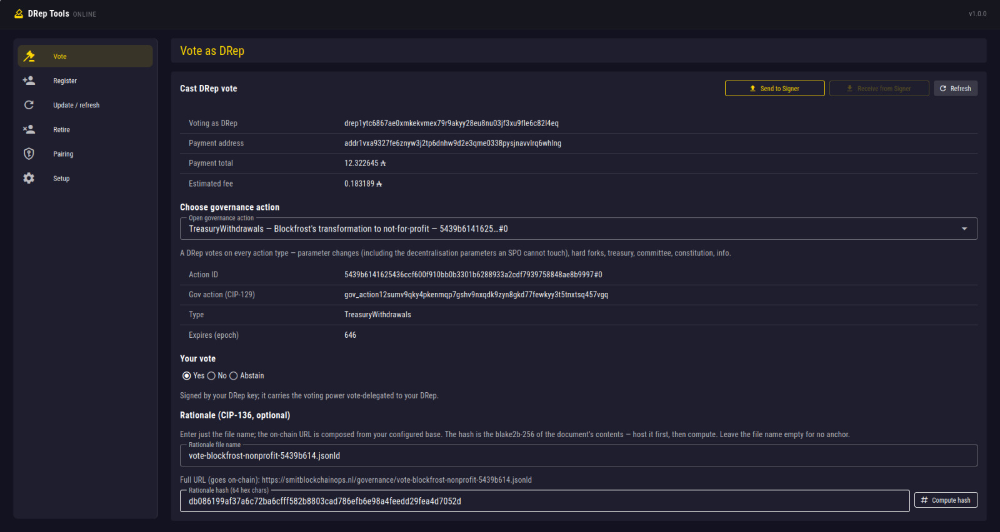
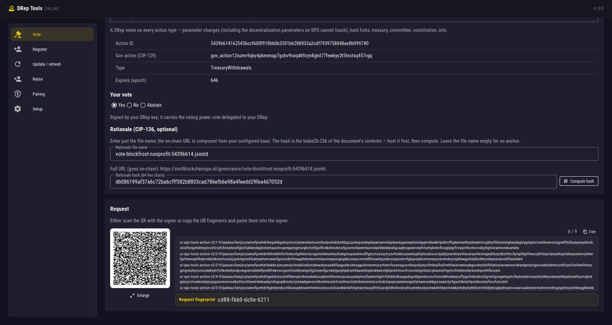
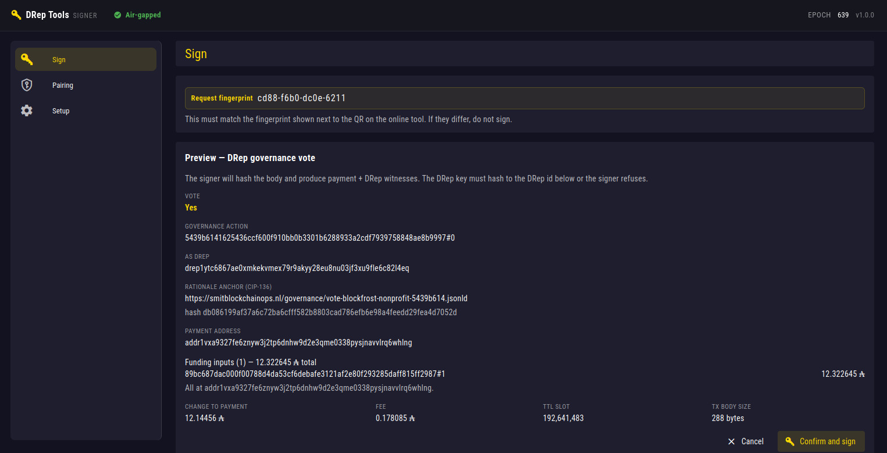
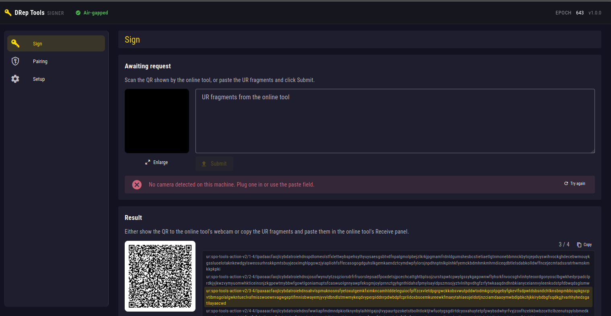
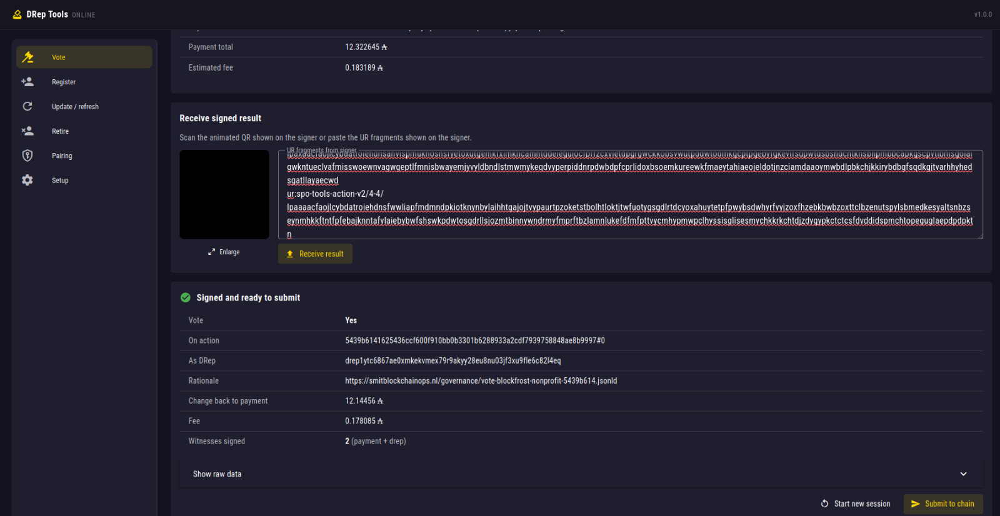
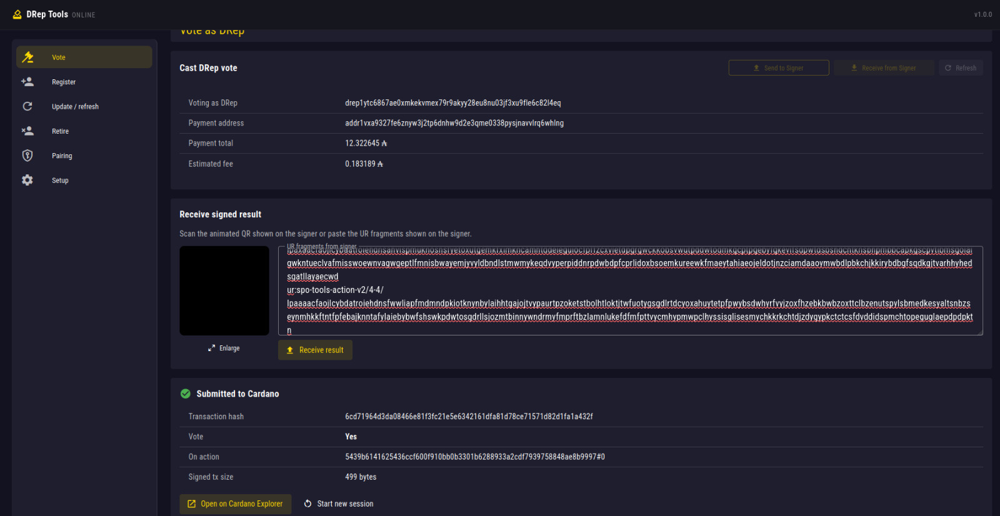

# DRep Tools

Cardano **DRep** (delegated representative) management toolkit. Air-gapped
signer plus online coordinator, with QR/UR fragments crossing the boundary
so the DRep signing key never touches the network. Each side runs a local
web UI in your browser, no CLI flags, no Haskell, no Plutus knowledge
needed.

Self-hosted, open source, Linux-only. No Docker, no SaaS, no mobile apps.

A companion to **SPO Tools**, built on the same role-neutral `airgap-core`
library. The two are fully separate: neither contains a line of the
other's code. Both depend only on `airgap-core`.

## Status

**v1.1.2**: full lifecycle (register / update / retire / vote) plus a
rationale-witness step (the CIP-100 author witness for a vote's CIP-136
metadata),
body-level validation on the signer, and an end-to-end encrypted channel
between online tool and signer. Built and tested: builder↔validator
round-trips for every operation, and an end-to-end sign-and-verify of both
witnesses on the signer. The air-gap transport is the same one SPO Tools
used to cast a real SPO governance vote on Cardano mainnet. The DRep
mainnet end-to-end (register → vote → refresh), and a live vote carrying a
witnessed rationale, are the remaining validation steps.

## Screenshots

A full DRep vote round-trip across the air-gap: from the online client to the
air-gapped signer and back. Every field is shown on the signer before anything is
signed.

**Online client: build a DRep vote**



**Request as an animated QR and UR fragments**



**Air-gapped signer: review and sign**



**Signer: receive the request and return the signed result**



**Online client: signed result received**



**Online client: submitted to Cardano**



## Features: the four DRep operations

- **Register**: `RegDRepCert` with the refundable deposit (500 ADA on
  mainnet, read live from Koios epoch params) and an optional CIP-119
  manifest anchor.
- **Update / refresh**: `UpdateDRepCert`. Two uses in one cert: point the
  on-chain anchor at an updated manifest, and **reset the activity
  counter**: a DRep that does not vote or refresh for `drep_activity`
  epochs (20 on mainnet) goes dormant and its voting power stops counting.
  A bare keep-alive with no new anchor is valid.
- **Retire**: `UnRegDRepCert`, refunding the deposit. The refund amount is
  read from Koios `drep_info` (what was actually locked at registration),
  not from the current parameter, they can differ if the deposit changed
  meanwhile.
- **Vote**: a `Voter::DRepKey` vote on any open governance action
  (parameter changes, hard forks, treasury, committee, constitution, info),
  with an optional CIP-136 rationale anchor. Unlike an SPO, a DRep votes on
  **every** action type, including the parameter groups (`k`/nOpt,
  minPoolCost, …) an SPO cannot touch.

Each operation is one small transaction: a single fee input from the
payment address, a single change output back to it, the DRep certificate
or voting procedure in the middle, and two witnesses, the **payment** key
spends the input, the **DRep** key authorises the action.

## Rationale witness (CIP-136)

A separate step, not a transaction. The online tool canonicalises a
hand-authored CIP-136 rationale body (URDNA2015, per CIP-100). The signer
signs its blake2b-256 with the DRep key, and the tool injects the CIP-100
author witness into the file. Without it a vote's anchor renders as raw
JSON instead of a rationale. The signer refuses to sign anything that is
not a canonical governance-metadata body, so the DRep key cannot be
steered into signing a transaction. Because the canonicalisation runs in
the online tool's browser, the signer does not take the rationale on
trust: it reads the text back out of the exact bytes it is about to sign
and shows it field by field, next to the raw canonical body. Check there
that it is the rationale you wrote. The signed rationale is published
like any manifest and referenced by the vote's anchor.

The channel between online tool and signer is **end-to-end encrypted**.
After a one-time visual-fingerprint pairing, every QR / UR payload is
sealed with X25519 + XChaCha20-Poly1305. A passive observer of the QR
channel sees only ciphertext. Substitution mid-channel is rejected by the
AEAD tag. A man-in-the-middle during the pairing dance is caught visually
because the 16-byte fingerprint on the two screens will not agree.
Operations refuse to run unpaired.

Every 4xx/5xx response from the online tool is a structured JSON envelope
(`{"code": "not_paired", "message": "..."}`) so integrations and tests can
dispatch on the stable `code` instead of parsing free-form text.

Both `drep-tools-online` and `drep-tools-signer` ship as single
self-contained binaries, the Vue frontend is embedded via `rust-embed`.
Copy the binary anywhere and run.

## Key isolation

The `drep-signer` holds only two keys: the **DRep signing key** and a
**payment signing key** (for fees and the deposit). Its config struct has
no field for a pool cold key, the binary cannot name, let alone load, the
operator's cold key. A compromise of the DRep signer cannot reach the SPO
role's keys, and vice versa.

Before signing, the signer additionally checks that the loaded DRep
verification key hashes (blake2b-224) to the DRep id named in the request.
A compromised online tool therefore cannot make the signer act as a
different DRep, the key that signs must be the DRep the request claims.

## Supported key formats

Two `cardano-cli` DRep signing-key forms are accepted:

- **Plain Ed25519**: `DRepSigningKey_ed25519`, as produced by
  `cardano-cli conway governance drep key-gen`.
- **Extended BIP32-Ed25519**: `DRepExtendedSigningKey_ed25519_bip32`, what
  a mnemonic-wallet owner gets by deriving the DRep key at CIP-105 path
  `1852'/1815'/account'/3/0` with `cardano-address` and converting with
  `cardano-cli key convert-cardano-address-key`. The signer detects the
  extended form automatically and signs scalar-based, it never treats an
  extended key as a 32-byte seed. On load it cross-checks the public key
  embedded in the skey envelope against the one derived from the secret.

The same two forms are accepted for the **payment** key
(`PaymentSigningKeyShelley_ed25519` /
`PaymentExtendedSigningKeyShelley_ed25519_bip32`).

DRep ids are accepted in either **CIP-105** (bare 28-byte key hash) or
**CIP-129** (header byte + hash) bech32. Script-based DReps are rejected,
this tool manages a key-based DRep only.

Hardware-wallet owners are not supported. The signer
works with CLI-exported keys only.

## Limitations (v1.1)

- Linux, x86-64 and arm64. For x86-64, prebuilt binaries ship in two builds: a standard
  **glibc** build (modern distributions, glibc >= 2.34: Ubuntu 22.04+,
  Debian 12+, Fedora 35+, RHEL/Rocky/Alma 9+, Arch, recent openSUSE) and
  a fully static **musl** build (`-musl`) that runs on any x86-64 Linux,
  including older LTS releases, Alpine, and minimal/live environments.
  Use `-musl` if the standard build reports `GLIBC_x.xx not found`. For arm64
  (Raspberry Pi 3/4/5, Zero 2, and other 64-bit ARM boards on a 64-bit OS), a
  fully static **`-arm64`** build is provided.
- Key-based DReps only (script / multi-sig DRep credentials are not supported).
- Identity management and voting only, proposing governance actions
  (submitting proposals, not just voting on them) is out of scope.

## Funding address

The payment address funds the transaction fee and, for registration, the
deposit. Change returns to it. The signer is air-gapped and cannot consult
the chain, so it trusts the inputs the online tool claims it picked,
mitigated by three independent layers:

1. The online tool sends the funding **inputs** (with their claimed
   addresses) alongside each request. The signer's body validator
   cross-checks `body.inputs` against `request.inputs` and rejects a tx
   whose inputs do not all sit at the request's `payment_address`.
2. The signer refuses to sign unless the request's payment address is
   controlled by the **payment key it holds** (the address's payment
   credential must be the hash of that key). The change can therefore only
   return to an address your own key can spend from, whatever the online
   tool names. Only the payment part is checked: an enterprise address or
   a base address with any stake part works.
3. The signer never signs a **fee above 3 ADA**, whatever the request
   says. An honest fee is about 0.17 to 0.2 ADA.
4. The signer decodes the transaction body and holds it against the
   request **before** showing anything, so the screen shows exactly what
   is being signed (DRep id, deposit / refund / vote, fee, change) for
   **visual review** before the DRep key is used. A request that
   misdescribes its body is refused without a preview.
5. An operator **PIN** (typed on the online tool, retyped on the signer)
   gates the actual signing.

Use a payment address you control directly. The registration deposit is
locked by the protocol and refunded in full when you retire.

## Air-gap is operator-enforced, not enforced by software

The signer process makes a best effort to detect that the host has no
network: at startup it shows a banner asking you to acknowledge the
air-gap, and a small monitor checks for IP traffic on connected interfaces
periodically (the top bar then reads "No network detected", which is all it
can honestly say). **Treat both as advisory.** No operation consults the
monitor. It gates nothing. A determined attacker who already
has shell access on the signer host can bring the network back up after the
check passes, and file-transfer channels (VM shared folders,
USB-passthrough, Bluetooth OBEX) are not detected at all. The trust anchor
is the operator keeping the signer host physically separated, not the
software detecting that separation.

## Governance metadata (CIP-119 + CIP-136)

Register and update can anchor a **CIP-119** manifest (identity,
motivations, objectives, qualifications). Each vote can anchor a
**CIP-136** rationale (summary, statement, references). An anchor is a URL
plus the blake2b-256 hash of the document, so the host need not be trusted,
the hash makes the document tamper-evident. Host the documents anywhere
stable (your own domain, IPFS). Never move or delete an anchored document:
the hash still matches but the pointer dangles and explorers can no longer
fetch the rationale.

The online tool can fetch a document URL to compute that hash for you. It
only fetches over `https://` and only from public internet addresses (not
from this machine, your local network or a cloud metadata address, also not
through a redirect), and it does not send your Koios API key along.

## Workspace layout

- `shared/`, DRep wire types + body validators
- `shared-frontend/`, Vue transport components, stores, formatters (the
  DRep tool's own copy, never imports SPO Tools)
- `drep-online/`, internet-connected coordinator (Axum + Pallas + Koios)
- `drep-signer/`, air-gapped signer (Pallas, no network)

All four build on the sibling **`airgap-core`** crate, the role-neutral
air-gap transport (X25519 + XChaCha20-Poly1305, UR/QR, pairing, PIN) and
Cardano primitives (tx assembly, body validation, key loading) shared with
SPO Tools. Check it out next to this repo:

```
parent/
  airgap-core/     (the shared library)
  drep-tools/      (this repo)
```

## Build

Requires Rust 1.95+ (stable) and Node.js 22+, with `airgap-core` checked
out as a sibling directory.

```bash
# 1. Frontend assets (embedded into the binaries at compile time)
npm install
( cd drep-online/frontend && npm run build )
( cd drep-signer/frontend && npm run build )

# 2. Rust binaries
cargo build --release
```

Binaries land in `target/release/drep-tools-online` and
`target/release/drep-tools-signer`. Both are self-contained. No further
runtime dependencies besides a modern Linux kernel and a recent browser to
drive the web UI.

## Tests

```bash
cargo test --workspace
```

Covers the CIP-105/129 id decoder, the four body validators plus the
DRep-key↔id binding, the payment-key↔address binding and the fee ceiling,
builder↔validator round-trips for all four operations, an end-to-end sign
that verifies both Ed25519 witnesses over the body hash, and the guard on
the document fetch.

## Quick start

### Online client (any networked machine)

```
./drep-tools-online --listen 127.0.0.1:8300
./drep-tools-online --listen 127.0.0.1:8300 --debug      # verbose tracing
```

`--listen ADDR:PORT` is required: there is no default port, both for
security and to allow side-by-side instances. For a self-hosted mainnet
Koios, add `--koios-url URL` (defaults to `https://api.koios.rest/api/v1`).
The URL must be https, or plain http on the same machine.

Open the URL printed at startup and complete Setup with your DRep id and
payment address. Saved to `~/.config/drep-tools/online.json`. The optional
Koios API key field is attached as `Authorization: Bearer <key>` to every
Koios request. Restart the online tool for a new key to take effect.

### Signer (air-gapped machine)

Mount your encrypted key storage (typically a LUKS-encrypted USB stick),
then:

```
./drep-tools-signer --listen 127.0.0.1:8301
```

Acknowledge the air-gap reminder, open the URL printed at startup and
configure the file paths to your DRep and payment signing keys. Keys are
read from disk on every sign, kept in memory only for the duration of the
operation. Config is saved to `~/.config/drep-tools/signer.json`.

### Pair the two sides (one-time, ~1 min)

Once both binaries are running, open **Pairing** in either UI. Each side
displays its own public key as a static QR. Scan the other side's QR with
the camera, and visually compare the 16-byte fingerprint shown on both
screens. They must match exactly. Click Confirm and the channel is
permanently encrypted between this online tool and this signer. Operations
refuse to run before pairing is complete.

### Workflow

Every operation follows the same five-step shape:

1. Fill in the form on the online client and click **Send to Signer**. A
   confirmation modal opens summarising the operation and asking for a
   4-digit **operator PIN**. Pick any 4 digits, you retype the same PIN on
   the signer in step 3.
2. The online client builds the request, encrypts it, and shows it as an
   animated QR plus a list of UR fragments alongside an 8-byte **request
   fingerprint** (e.g. `a37f-2c91-5be2-c8d4`).
3. The signer scans the QR (or accepts pasted UR fragments), decrypts the
   payload, displays the same fingerprint and an operation-specific
   preview. Verify the fingerprint matches the one on the online tool,
   click **Confirm and sign**, and retype the PIN. The signer refuses to
   sign on PIN mismatch, or if the loaded DRep key does not hash to the
   request's DRep id.
4. The signer encrypts the result and shows it as another QR / UR sequence.
5. The online client scans (or pastes) the result and submits the signed
   transaction to Koios.

Both sides accept UR fragments either via webcam-scanned QR or pasted as
text.

## Maintainer

Smit Blockchain Operations (Pool BKIND), <developmentbkind@gmail.com>

## Support this work

If you want me to continue maintaining and expanding these tools for the
Cardano ecosystem, please support it by delegating your stake:

- **Delegate to pool BKIND**
  (`pool1m83drqwlugdt9jn7jkz8hx3pne53acfkd539d9cj8yr92dr4k9y`)

This keeps the work visible and sustainable. Thank you.

## Security

Found a vulnerability? See [SECURITY.md](SECURITY.md) for disclosure.

## Disclaimer

This software is provided "as is", without warranty of any kind, express or
implied, as set out in the MIT and Apache-2.0 licenses below. It constructs,
signs, and submits real transactions on the Cardano mainnet using your
private keys.

You alone are responsible for:

- safeguarding your signing keys (DRep, payment),
- verifying every transaction on the signer's screen before you approve it,
- the outcome of any transaction you sign and submit.

To the fullest extent permitted by law, the author accepts no liability for
any loss or damage, including loss of funds, keys, or voting power,
arising from the use of, or inability to use, this software. Use it at your
own risk.

Nothing here is financial, tax, or legal advice. Always confirm against the
on-chain state and your own records.

This is open source so that you never have to take it on trust. In case of
any doubt, read the source, or have someone you trust check it for you,
before you rely on it.

## License

Dual-licensed under [MIT](LICENSE-MIT) or [Apache 2.0](LICENSE-APACHE),
at your option.
